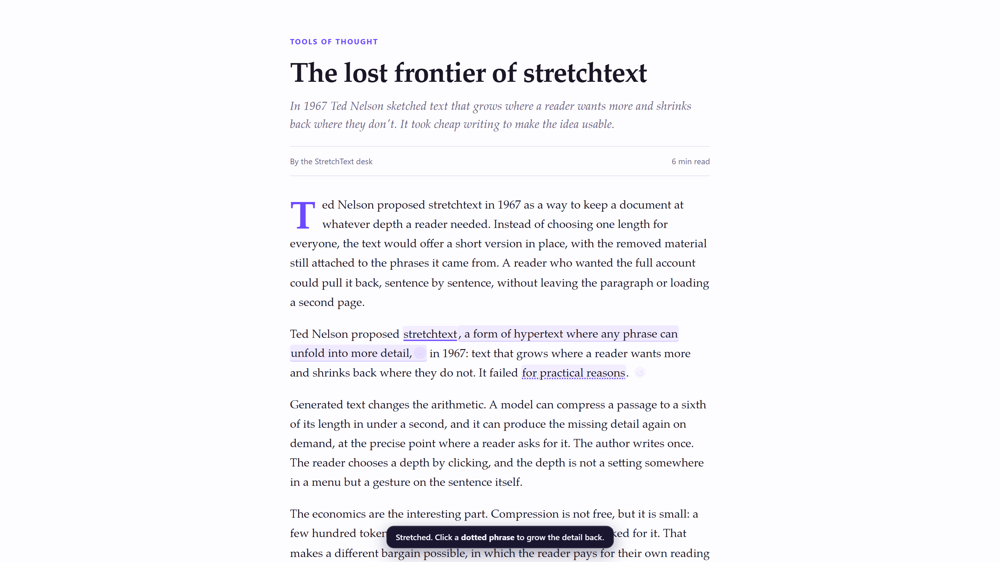

# StretchText — grow any page

[](https://pollinations.ai/?ref=badge)

A browser extension that turns any web page into **stretchtext**: select a passage, get a short version
in place, and click a dotted phrase to grow the detail back exactly where it stands.



Built for [Pollinations quest #17998](https://github.com/pollinations/pollinations/issues/17998). Readers
sign in with their own Pollen ([BYOP](https://github.com/pollinations/pollinations/blob/main/BRING_YOUR_OWN_POLLEN.md)),
so every request spends the reader's balance, not the app's. There is no backend.

## Why

Ted Nelson described stretchtext in 1967: text that grows where the reader wants more and shrinks back
where they don't. Hand-writing every level never paid off. Generating the levels is cheap enough now, so
the reader can choose a depth with a gesture instead of a setting.

## How it works

1. **Select** a sentence, a paragraph, or several blocks on any page. A small **Stretch** bubble appears
   (or press <kbd>Alt</kbd>+<kbd>S</kbd>, or right-click → *Stretch with StretchText*).
2. The selection is replaced **in place** by a kernel of roughly one sixth of its length. The original
   nodes are kept aside in memory, so nothing is lost.
3. The model wrapped two or three short phrases in `{{…|n}}` markers. Those render as dotted, clickable
   phrases. **Click one** and the detail that was cut there streams back in, inline, after the phrase.
4. Click the small `−` to shrink it again, or the `↺` at the end of the passage to put the original text
   back. <kbd>Alt</kbd>+<kbd>Shift</kbd>+<kbd>S</kbd> restores every stretched passage on the page.

The kernel streams in token by token. Markers are parsed out of the partial stream, so a half-written
`{{in 18` never leaks braces into the page.

## Install (unpacked)

Chrome, Brave, Edge — any Chromium 110+.

```bash
git clone https://github.com/<you>/stretchtext
```

1. Open `chrome://extensions` and enable **Developer mode**.
2. **Load unpacked** → pick the `stretchtext` folder (the one with `manifest.json`).
3. Pin the extension, open any article, select a paragraph, press <kbd>Alt</kbd>+<kbd>S</kbd>.

There is no store listing yet; unpacked is the intended install path for now (see *Status*).

## Connect your Pollen

Click the extension icon → **Sign in with Pollinations**.

The extension uses the [device flow](https://github.com/pollinations/pollinations/blob/main/BRING_YOUR_OWN_POLLEN.md#-clis--headless-apps-device-flow):

1. `POST https://enter.pollinations.ai/api/device/code` → a short code and a verification link.
2. The approval page opens in a tab; you pick a budget and expiry there.
3. While it is open, the extension polls `/api/device/token` and stores the resulting `sk_…` key in
   `chrome.storage.session` — memory only, gone when the browser closes.

Your password never touches the extension, the key never reaches a web page, and the key is only ever
sent to `gen.pollinations.ai`. Signing out drops it immediately.

You can also paste an existing `sk_…` key into the popup. The optional **App Key** (`pk_…`) field in
settings is for attribution if you publish your own fork with a registered app.

## Cost

One stretch = one chat completion, one phrase expansion = one more. With a cheap model such as
`openai/gpt-5.4-nano`, a paragraph costs a small fraction of a Pollen. Every result is cached per session:
shrinking and re-growing a phrase, or re-stretching the same paragraph, costs nothing.

Models are chosen in the popup (`openai/gpt-5.4-nano` by default). Any text model from
`https://gen.pollinations.ai/text/models` works — type its id into the model field if it is not listed.

## Privacy

- Page text is sent to Pollinations only when you explicitly stretch or expand something.
- Nothing about the page is stored on disk: kernels and expansions live in the current page and in the
  service worker's memory, and are dropped when the tab or the worker goes away.
- The API key is kept in `chrome.storage.session` and never exposed to page scripts.
- No analytics, no remote config, no third-party hosts beyond `gen.pollinations.ai` and
  `enter.pollinations.ai`.

## Architecture

```
manifest.json          MV3, one content script, one service worker, one popup
src/core.js            pure helpers: marker parser, prompts, SSE reader, chunking (UMD, testable in node)
src/background.js      every network call; streams text to the page over a port; session cache
src/content.js         selection → ranges → kernel → inline expand/collapse/restore
src/content.css        the whole page-level look, prefixed and scoped
src/popup.*            status, sign-in, model/length/language
src/auth.*             device-flow page that polls for the key
```

Design notes that took the longest to get right:

- **Nothing is destroyed until the answer arrives.** Two invisible marker spans bracket the selection
  and a CSS `::highlight` dims it while the request runs; the original nodes are only detached when the
  first token arrives, and they are restored on any error.
- **Streaming-safe rendering.** `parseSegments()` is incremental: it accepts a half-written marker,
  ignores duplicate ids, and falls back to plain text for anything malformed, so the page never shows
  `{{` or `|1}}`.
- **Phrases are inert until the kernel is final.** A click during streaming would be wiped by the next
  re-render, so the root carries `data-st-state="streaming|done"` and the click handler ignores the
  streaming state.
- **The detail must read as an insertion.** The prompt asks for the words to insert *after the phrase*,
  punctuation included; `normalizeDetail()` adds a comma if the model forgets, so the sentence stays
  grammatical.

## Tests

```bash
node test/core.test.mjs     # 24 unit tests, no network, no browser
node test/e2e.mjs           # real Chrome + real extension against a local mock API
```

`npm test` runs the first one through `node --test`; `node test/e2e.mjs` drives Chrome for Testing over
the DevTools protocol with zero npm dependencies. The suite checks the whole path — selection, kernel,
streamed markers, phrase expansion, shrink, byte-identical restore, popup state — and that the service
worker attaches the reader's key and asks for a stream.

The e2e run needs a Chromium binary that still honours `--load-extension`:

```bash
node tools/get-chrome.mjs   # downloads Chrome for Testing into test/.artifacts (gitignored)
```

`HEADFUL=1 node test/e2e.mjs` shows the browser.

Tests run against `test/mock-api.mjs`, an OpenAI-compatible SSE stand-in, so the suite spends no Pollen
and needs no account. Production requests go to `gen.pollinations.ai` unchanged.

## Status

- Chromium only (MV3). Firefox needs a `browser.*` shim and `manifest` tweaks — not done yet.
- Not published to the Chrome Web Store; the install page is
  [docs/index.html](docs/index.html) and the repo itself.
- Works on any `http(s)` page. Chrome's own pages, the Web Store and PDFs are off limits, as usual.
- Restoring after a page re-renders its own DOM (SPA navigations) can lose the saved nodes; the extension
  then leaves the page alone.

## License

MIT.
